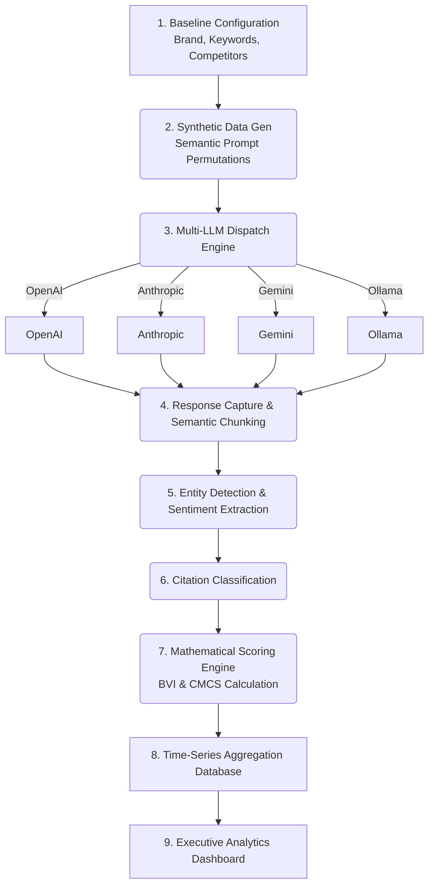

# Enterprise AI Visibility Observatory: Architecture & Implementation Plan

## 1. Project Overview & Background
The **Enterprise AI Visibility Observatory** is a comprehensive framework designed to measure, analyze, and monitor how organizations are represented across Large Language Models (LLMs) like ChatGPT, Claude, Gemini, and Perplexity. With the paradigm shift from traditional Search Engine Optimization (SEO) to **Answer Engine Optimization (AEO)**, organizations face a visibility blindspot. This project introduces a continuous, automated testing pipeline that transforms opaque AI outputs into mathematically verifiable telemetry.

## 2. High-Level System Architecture

## 3. Detailed Implementation: Front-End Configuration to LLM Refinement

### Step 3.1: HTML Frontend Configuration (Baseline Input)
The pipeline begins with a user-facing HTML/web application where organizations input their baseline domain context.
*   **Input Parameters**: Brand Name, Target Keywords, Competitor Names, Product Categories.
*   **Extraction & Submission**: The web frontend captures these parameters (e.g., via a React/Next.js dashboard form) and submits a structured JSON payload to the backend orchestrator.

### Step 3.2: Synthetic Data Generation Layer
Instead of manually typing prompts, the system uses an LLM to dynamically generate hundreds of user-intent queries based on the baseline parameters.
*   **Process**: The system feeds the baseline JSON into a "Prompt Generation Agent". 
*   **Output**: A massive array of diverse prompts simulating how real users might query AI engines.
    *   *Informational*: "What are the best enterprise AI visibility tools?"
    *   *Comparative*: "Compare [Brand] and [Competitor] for AEO."
    *   *Transactional*: "How much does [Brand] cost?"

### Step 3.3: Multi-LLM Dispatch Engine
A high-throughput Python orchestration engine (using `asyncio` and queues) that concurrently dispatches the generated synthetic prompts across various LLM APIs (OpenAI, Anthropic, Gemini) and local models (Ollama).

### Step 3.4: Response Capture, Semantic Chunking, & NLP Refinement
This is the critical phase where raw, non-deterministic LLM text is refined into strict, structured expected output.
1.  **Response Capture**: Raw string answers are captured from the various LLMs.
2.  **Semantic Chunking**: The large textual responses are split by paragraph or semantic boundaries to isolate contexts.
3.  **NLP Refinement (LLM-as-a-Judge)**: The chunks are sent to a dedicated NLP Evaluation LLM (e.g., GPT-4o with structured JSON mode enabled). This LLM is instructed *strictly* to analyze the chunk and output JSON containing:
    *   `brand_mentions`: List of detected entities.
    *   `sentiment`: Positive, Neutral, or Negative.
    *   `citations`: URLs, explicit sources, or implicit sources mentioned.

### Step 3.5: Mathematical Scoring Engine
The structured JSON outputs are aggregated to calculate core mathematical metrics:
*   **Brand Visibility Index (BVI)**: Overall share of voice across the models.
*   **Cross-Model Consistency Score (CMCS)**: How uniformly different LLMs (e.g., Gemini vs Claude) recommend the organization.
*   **Citation Authority Score (CAS)**: Weighted score of how often authoritative third-party sources (like high-ranking review sites) are cited when the brand is mentioned.

## 4. Phased Implementation Plan

### Phase 1: Configuration Interface & Prompt Synthesis (Currently In Progress)
*   [x] **Backend API & Models**: Created strict schema models (`src/models.py`).
*   [x] **Synthetic Prompt Generator**: Implemented LLM pipeline to ingest configuration and output prompt permutations (`src/prompt_generator.py`).
*   [ ] **Web Frontend**: Build the HTML/React dashboard for users to input Brand, Keywords, and Competitors.

### Phase 2: Multi-LLM Dispatch Architecture
*   [ ] **API Integrations**: Implement official SDKs for OpenAI, Anthropic, and Google Gemini.
*   [ ] **Local Model Support**: Set up an Ollama instance to test open-source model behavior (e.g., Llama-3).
*   [ ] **Concurrent Dispatcher**: Build the asynchronous dispatcher to fire prompts concurrently, handle rate limits, and capture raw responses.

### Phase 3: NLP Refinement & Mathematical Scoring
*   [ ] **Semantic Chunker**: Implement the logic to break down multi-paragraph LLM responses.
*   [ ] **Entity & Sentiment Extraction**: Use structured JSON outputs (via LLM function calling/JSON mode) to extract brand mentions, citations, and sentiment accurately.
*   [ ] **Scoring Engine**: Implement the mathematical formulas for BVI, CMCS, and CAS based on the extracted JSON arrays.

### Phase 4: Database Aggregation & Executive Dashboard
*   [ ] **Time-Series DB**: Setup a database (e.g., PostgreSQL + TimescaleDB) to store historical chunk evaluations and scores.
*   [ ] **Dashboard UI**: Build the executive views to track visibility trends, citation half-life decay, and competitive market share over time.
*   [ ] **Automated Scheduling**: Implement chron jobs to run the entire pipeline weekly to establish longitudinal citation studies.
